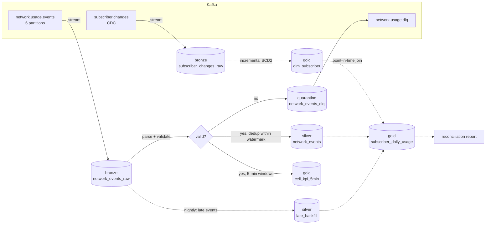

# Telecom network-events streaming pipeline

Kafka → Spark Structured Streaming → Hive pipeline for telecom network and subscriber data.
It ingests high-volume usage events (data sessions, voice calls, SMS, dropped calls) and billing CDC,
and turns them into clean events, real-time cell KPIs, an SCD Type 2 subscriber dimension and
point-in-time daily usage. Every step is reconciled back to the Kafka offsets.

[](https://github.com/sumaksharikaa/telecom-kafka-streaming-pipeline/actions/workflows/ci.yml)

CI runs the full scenario twice: once in file mode, and once against a **real Kafka broker** (service container).

## Architecture



Solid lines are streaming queries (each with its own checkpoint). Dotted lines are batch jobs.
Kafka is read **once** per topic into bronze; everything downstream streams from bronze, so a
replay or a fix re-reads bronze, not the brokers.

## What it demonstrates

| Area | How |
| --- | --- |
| Kafka ingestion | Idempotent producer (`acks=all`), keyed by subscriber, 6 partitions; Spark Kafka source with `maxOffsetsPerTrigger`, `failOnDataLoss` |
| Exactly-once landing | Checkpointed file sinks; reconciliation proves every offset landed once and none are missing |
| Data quality | 7 validation rules; bad records go to a DLQ table **and** a DLQ topic with the original bytes and source offset, so they can be replayed |
| Deduplication | `dropDuplicatesWithinWatermark` on `event_id`, so producer redeliveries are removed with bounded state (RocksDB state store) |
| Late data | Events behind the 2-hour watermark are left out of streaming state, then recovered from bronze by an idempotent nightly backfill |
| Windowed aggregation | 5-minute tumbling cell KPIs: data MB, voice calls, dropped calls, drop rate, active subscribers |
| Incremental CDC | SCD Type 2 subscriber dimension: only LSNs above the high-water mark are read, and only affected subscribers are rebuilt. Backdated changes land in effective-time order |
| Point-in-time join | Daily usage is split by the plan in effect at each event's time, not today's plan |
| Hive | All zones registered as external partitioned tables plus `network_events` and `subscriber_current` views |
| Incremental batch | Daily usage rewrites only the affected `event_date` partitions (dynamic partition overwrite) |
| Reconciliation | Kafka offsets → bronze → valid + DLQ → silver + backfill → daily usage; the job exits non-zero on any mismatch |

## The scenario (run by `scripts/run_e2e.py`, and in CI)

The simulator builds one deterministic day: 1,500 subscribers, 80 cells in 4 markets,
45,840 events, and 1,576 CDC messages. It sends the day in two phases:

| Phase | What arrives |
| --- | --- |
| 1 | Subscriber snapshot, 60 daytime plan changes and a disconnect, events up to 20:00 |
| 2 | Events from 20:00 to 24:00, **300 events hours late**, **10 backdated plan changes** (new LSN, earlier effective time) and 5 redelivered CDC messages |
| Both | 400 producer redeliveries and 250 bad records: malformed JSON, wrong schema version, missing fields, unknown event types, invalid service codes, bad timestamps, negative usage |

The simulator also writes the ground truth. The e2e script checks the pipeline against it:

```
phase 2
  [ok] reconciliation passed: True
  [ok] late events recovered from bronze: 300
  [ok] redeliveries removed: 400
  [ok] DLQ by reason: {'BAD_TIMESTAMP': 35, 'INVALID_EVENT_TYPE': 36, ...}
  [ok] clean events: 45840
  [ok] only new CDC applied (redeliveries skipped): 10
  [ok] usage rows matching ground truth on every metric: 1590
  [ok] unknown (roaming) subscribers kept, not dropped: 20
  [ok] SCD2 versions: 1571
  [ok] KPI windows matching a recount of silver: 0
re-run with no new data
  [ok] backfill adds nothing: 0
  [ok] no CDC re-applied: 0
ALL EXPECTATIONS MET
```

Phase 2 runs in a new process, so it also shows that the stream resumes from its checkpoints.

## Run it

You need Python 3.11+ and Java 17.

```bash
make install
make test        # 30 tests, incl. real streaming queries (dedup, watermark, restart)
make e2e         # the full scenario in file mode (no broker needed), about 2.5 minutes
```

With Docker (Kafka in KRaft mode plus the continuous streaming job):

```bash
make up                  # kafka + stream
make produce PHASE=1     # send traffic into Kafka
make batch               # SCD2, backfill, daily usage, Hive tables, reconciliation
make produce PHASE=2 && make batch
make e2e-kafka           # or the scripted scenario against localhost:9092
```

**File mode** (`source_mode: file`) replaces the broker with Kafka-shaped JSON files that have
the same key/value/topic/partition/offset columns and real per-partition offsets. Only the
bronze source changes, so the rest of the code is identical in both modes.

## Tables

| Table | Grain | Partitioned by |
| --- | --- | --- |
| `telecom.bronze_network_events` | one Kafka record | `ingest_date` |
| `telecom.bronze_subscriber_changes` | one CDC record | `ingest_date` |
| `telecom.silver_network_events` | one clean, deduplicated event (streamed) | `event_date` |
| `telecom.network_events_late_backfill` | one late event recovered from bronze | `event_date` |
| `telecom.network_events_dlq` | one rejected record + reason + source offset | `ingest_date` |
| `telecom.cell_kpi_5min` | cell × 5-minute window | `window_date` |
| `telecom.dim_subscriber` | subscriber version (SCD2: `valid_from`, `valid_to`, `is_current`, `is_deleted`) | |
| `telecom.subscriber_daily_usage` | subscriber × day × plan × market | `event_date` |
| `telecom.network_events` (view) | silver ∪ backfill | |

## Design notes

- **Why the watermark and a backfill?** Unbounded dedup state would grow forever. A 2-hour watermark keeps
  state small, and late events aren't lost: they're in bronze, and the nightly backfill adds any valid
  event that silver doesn't have. Re-running it adds nothing.
- **Why rebuild a subscriber's whole timeline?** A backdated change has a new LSN but an old effective time.
  Appending it would give the wrong plan for part of the day. Rebuilding only the touched subscribers keeps
  the merge incremental and still correct.
- **Why separate the backfill from silver?** Silver is a streaming file sink with its own commit log
  (`_spark_metadata`). Writing batch files into it would be invisible to readers that trust that log.
- **Ordering:** events are keyed by `subscriber_id`, so one subscriber's events stay in order within a partition.

## Layout

```
conf/pipeline.yaml                  topics, watermark, validation rules, thresholds
src/telecom_stream/
  simulator.py                      traffic + CDC generator, Kafka and file sinks, ground truth
  sources.py                        Kafka / file source, DLQ topic shape
  transforms.py                     parse, validate, dedup, cell KPIs, CDC parsing
  streaming_job.py                  the streaming queries (available-now or continuous)
  subscribers.py                    incremental SCD2 dimension
  usage.py                          late-event backfill, point-in-time daily usage
  reconcile.py                      offset and record-count reconciliation
  hive.py                           external tables and views
  batch.py                          batch CLI
scripts/run_e2e.py                  the two-phase scenario with assertions
tests/                              unit and streaming tests
docker/, docker-compose.yaml        Kafka (KRaft) + pipeline image
```

All data is synthetic. No real subscriber, network, or company data is used.
